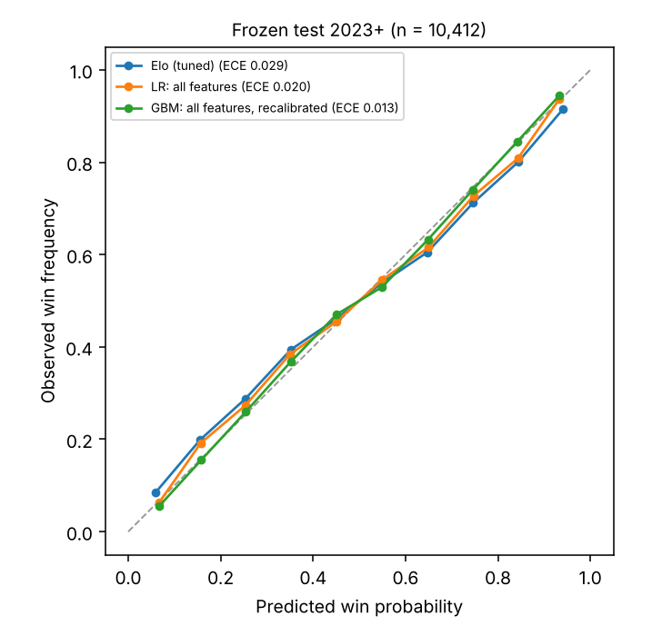

# tennis-elo

Predicting ATP tour-level match outcomes with Elo variants and gradient boosting, using DuckDB/SQL as
a leakage-safe feature layer. The aim is a carefully validated model with honest uncertainty, not a
claim of beating the betting market (closing lines are very sharp).

**Status: v0.5 complete. Full write-up: [`docs/REPORT.md`](docs/REPORT.md).**
v0.4: Leakage-safe SQL feature layer, tuned Elo ladder, logistic regression and
LightGBM, with calibration, SHAP, error analysis, ablations and a one-shot frozen-test evaluation.

## At a glance

- **What it does:** predicts the winner of ATP tour matches from information available before the match,
  and measures what each ingredient (rankings, Elo, form and fatigue, court pace, extra rating data) adds.
- **Result:** on a test set scored once (2023 onwards, 10,412 matches) the best model reaches log loss
  0.607 [0.596, 0.618] and about 66% accuracy, against 0.631 for a rankings-only model and 0.626 for tuned Elo.
  The gain is real and stable across years, but small. No comparison with betting odds was made.
- **What did not work:** rating trend, Glicko uncertainty, a serve/return point model and rank-seeded
  starting ratings all failed to improve on the simpler model. Reported in full, not hidden.
- **What I would point to:** leakage tests that were shown to fail when a leak is planted, a split frozen
  before modelling, tournament-clustered bootstrap intervals, and exactly antisymmetric models.
- **Stack:** Python, DuckDB/SQL, scikit-learn, LightGBM, SHAP. 80 tests.



*Predicted win probability against observed frequency on the frozen test set. Closer to the diagonal
is better; the recalibrated gradient-boosting model has the lowest expected calibration error (0.013).*

Start with [`docs/REPORT.md`](docs/REPORT.md) for the full write-up.

## Question

Does surface-aware Elo, or a model on lagged form, fatigue and court-pace features, predict ATP
matches better than a ranking baseline, and by how much (with confidence intervals)?

## Quick start

```bash
make setup                     # pip install -e ".[dev]"
make data                      # download atp_matches_2000..now into data/raw
#   or: make data FROM=/path/to/folder/with/atp_matches_YYYY.csv
make build                     # raw CSVs -> data/tennis.duckdb
make build-aux                 # v0.5: add qualifying/Challenger CSVs (data/raw_quali, data/raw_chall)
make baseline                  # ranking baseline on train/validation years
make leakage                   # truncation + perturbation leakage checks on the built database
make pace-tune                 # re-tune court-pace smoothing on training years
make elo                       # v0.3 Elo ladder (tuned on 2008-2021, reported on 2022)
make tune                      # v0.4 hyperparameters, expanding-window on 2018-2021
make validate                  # v0.4 validation report: tables, calibration, SHAP, ablation
make v05                       # v0.5 feature-step comparison (rolling origin 2018-2022)
make final-test                # ONE-OFF frozen-test milestone (refuses to run twice)
make test
```

## Design decisions

- **Symmetric rows.** Each match is labelled player A / player B by a hash of `match_id`, so the
  winner is not always "player 1". The target is `a_wins`. See `sql/20_match_sides.sql`.
- **Leakage.** Columns from `minutes` to `l_bpFaced` describe the match itself. They only enter
  features through windows that end strictly before the match, ordered by `ord_num` (tournament
  week, then round; see `sql/10_matches.sql`). `make leakage` deletes the future and overwrites
  in-match stats (one week at a time) and checks that no feature moves; the tests also inject a deliberate leak to prove
  the checks fail when they should.
- **Court pace** is keyed by event, surface and indoor/outdoor: per-match ace and serve-points-won
  residuals against the players' own lagged records, pooled over the event's previous editions, plus a
  running in-tournament value. Tuned on training years only: it explains most of the edition-level
  variation that surface alone misses (error 0.100 -> 0.060). Details in `docs/feature_plan.md`.
- **Return stats are derived.** The source has no return columns; they are the opponent's serve
  stats inverted (`sql/25_player_matches.sql`).
- **Walkovers and defaults** are excluded from ratings and training. Retirements are kept and
  flagged; handling them in the Elo update is a v0.3 ablation.
- **Frozen split** (`src/tennis/__init__.py`): train <= 2021, validation 2022, test >= 2023. The
  test years are only evaluated at milestone points, never during development.

## Where the SQL lives

The feature layer is SQL run in DuckDB, in two places:

- `sql/` (run in order by `make build`): `10_matches.sql` (clean matches, ordering key `ord_num`, flags
  for team events and walkovers), `20_match_sides.sql` (hash-assigned player A/B rows),
  `25_player_matches.sql` (one row per player per match, with derived return statistics).
- Generated by Python so parameters stay in one place: lagged form, fatigue and entry features
  (`src/tennis/features.py`), court pace (`src/tennis/pace.py`) and the v0.5 qualifying/Challenger
  table (`src/tennis/aux.py`). Every window ends strictly before the match it feeds.

## Layout

```
sql/        numbered build steps (matches, symmetric sides, long player_matches)
src/tennis/ download, score parsing, build, features and court pace (SQL generators), pace tuning,
            leakage checks, Elo and Glicko engines, Elo ladder, point model, qualifying/Challenger
            loader, modelling frame, models, reports, metrics, CLI
tests/      score parsing, pipeline invariants, symmetry, determinism, split discipline, ratings
docs/       REPORT.md (start here), per-milestone write-ups, tables and figures
data/       empty placeholders; raw data is not committed
```

## Roadmap (scoped down: the market is sharp, so this stays small)

| Step | Content |
|---|---|
| v0.1 | Data layer, symmetric table, ranking baseline |
| v0.2 | SQL feature layer: form, dominance ratio, rest and fatigue, court pace, leakage tests (built) |
| v0.3 | Elo ladder: fixed/dynamic K, surface blend, layoff, margin of victory, best-of-5 (built) |
| v0.4 | Logistic regression and LightGBM, calibration, bootstrap CIs, SHAP, error analysis, pace ablation (built) |
| v0.5 | Qualifying and Challenger results in Elo (kept, about -0.003 log loss); rating trend, Glicko, point model (dropped); `docs/v05_improvements.md` (built) |

## Results

Population: ordinary tour matches (Davis Cup, Laver Cup, ATP Cup, United Cup and Next Gen Finals
excluded). Log loss, lower is better, with 95% intervals that resample whole tournaments. A coin flip
scores 0.6931. Validation 2022 (n = 2,630) was used to compare models; the **frozen test, 2023 onwards
(n = 10,412), was scored once** with models refitted on 2003-2022 and nothing re-tuned. Data snapshot:
`docs/data_snapshot.md`.

| Model | Validation 2022 | Frozen test 2023+ | Test accuracy |
|---|---|---|---|
| Higher-ranked player wins (as a probability: logistic on log rank ratio) | 0.6318 | 0.6314 [0.6214, 0.6418] | 63.8% |
| Elo, tuned (v0.3) | 0.6131 | 0.6258 [0.6152, 0.6366] | 64.2% |
| Logistic regression, all features | 0.5960 | 0.6095 [0.5979, 0.6210] | 66.1% |
| LightGBM, all features, recalibrated | 0.5967 | 0.6069 [0.5961, 0.6175] | 65.7% |
| Average of the two | 0.5950 | 0.6066 [0.5956, 0.6175] | 65.9% |

The best model beats ranks by 0.025 log loss and tuned Elo by 0.019 on the test set (both intervals
exclude zero), and the gain holds in each of 2023-2026. Honest reading: that is a real, stable
improvement but a small one, the logistic regression matches the GBM within noise, and nothing
here is compared with betting-market prices. Pace: static court pace helps by about 0.0007 log loss
(significant only for the logistic regression); running pace, indoor/outdoor and altitude add nothing
detectable. Details, calibration, SHAP, error slices and ablations: `docs/models.md`; Elo ladder:
`docs/elo_ladder.md`.

## Data and licence

Two interchangeable sources with the same core columns. Use **one per raw directory** (mixing is
refused, since it would duplicate matches):

- **TennisMyLife** (<https://stats.tennismylife.org/tennis-match-database>): `YYYY.csv`, ATP player
  IDs, an extra `indoor` column, updated daily. Stated licence: MIT; it says it is enriched from
  other sources, so check its terms before redistributing anything derived.
  `make data` with `--source tml`, or drop the CSVs in and use `FROM=`.
- **Jeff Sackmann's tennis_atp** (<https://github.com/JeffSackmann/tennis_atp>): `atp_matches_YYYY.csv`,
  licensed [CC BY-NC-SA 4.0](https://creativecommons.org/licenses/by-nc-sa/4.0/) (non-commercial,
  attribution, share-alike). Credit: Tennis databases, files, and algorithms by Jeff Sackmann /
  Tennis Abstract.

Player IDs differ between the two sources, so their files cannot be joined on `player_id`.
The source changes daily, so **pin a snapshot** (date and file hashes) before evaluating on the
frozen test years. Qualifying and Challenger CSVs (`data/raw_quali`, `data/raw_chall`, used for v0.5 ratings) are likewise git-ignored. Raw data and derived databases are git-ignored and not redistributed.

### Qualifying and Challenger data (v0.5)

`data/raw_quali/YYYY.csv` (2007-2026) and `data/raw_chall/YYYY.csv` (2000-2026) use the same column
layout as the main match files and were supplied by the author from the same family of ATP results
sources. They are used only to update ratings and are never predicted. Check each source's licence
before reusing or redistributing them.

## Acknowledgements

- **Jeff Sackmann / Tennis Abstract** for the open ATP data that this whole field builds on
  ([tennis_atp](https://github.com/JeffSackmann/tennis_atp), CC BY-NC-SA 4.0): "Tennis databases, files,
  and algorithms by Jeff Sackmann / Tennis Abstract".
- **TennisMyLife** ([stats.tennismylife.org](https://stats.tennismylife.org/tennis-match-database)) for
  the daily-updated match files the reported results were computed on.
- **Elo** (1978), *The Rating of Chessplayers*, and **Glickman** (1999), "Parameter estimation in large
  dynamic paired comparison experiments", for the rating systems.
- Open-source tools: DuckDB, pandas, NumPy, scikit-learn, LightGBM, SHAP, matplotlib, pytest.

Because the data sources carry non-commercial and share-alike terms, treat this repository as a
non-commercial portfolio and research project. The MIT licence covers the code and write-ups only.
Not affiliated with the ATP.
